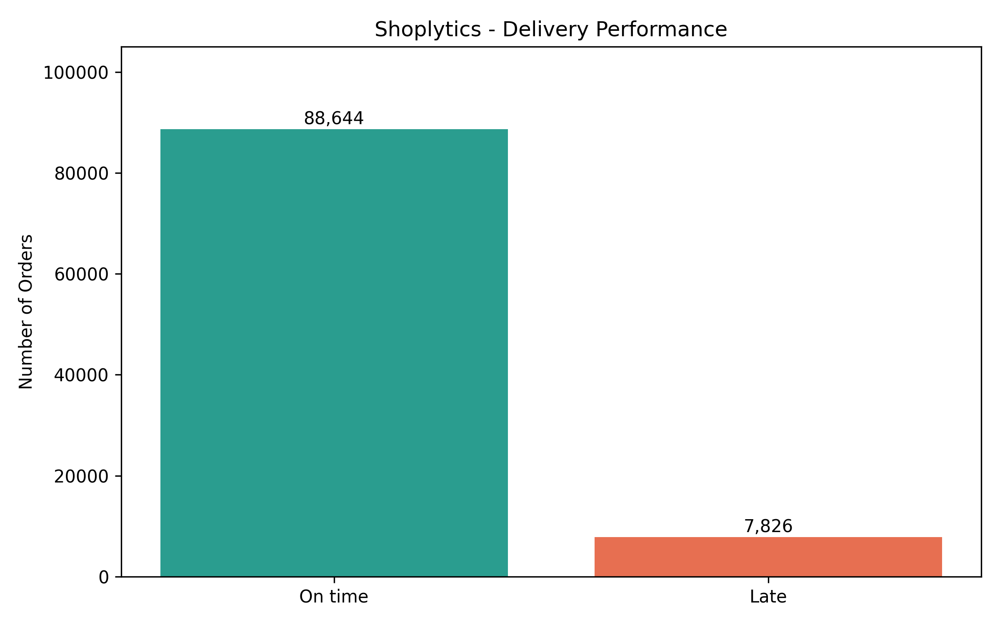
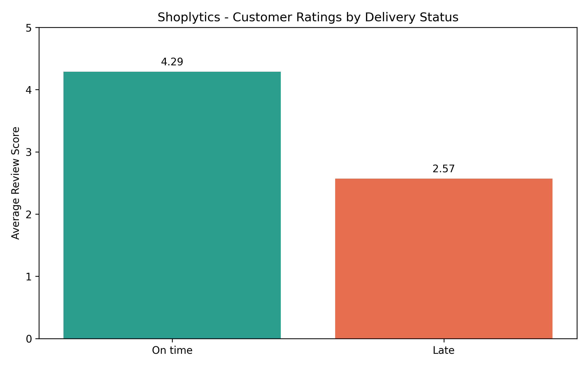
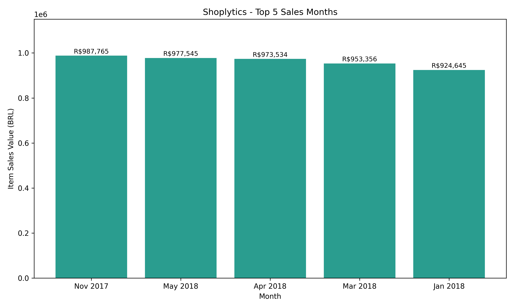
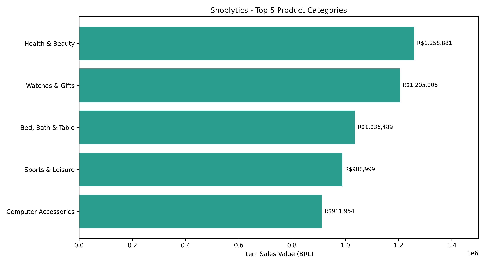

Shoplytics: E-Commerce Sales and Performance Analysis

1. Executive Summary

Shoplytics is a data analytics project examining sales performance, customer satisfaction, product demand and delivery efficiency using the Brazilian Olist e-commerce dataset.

The project uses PostgreSQL for data storage and SQL analysis, alongside Python and Matplotlib for visualization.

The analysis identifies important relationships between delivery performance and customer experience, as well as sales patterns across product categories and months.

2. Project Objectives

The main objectives are to:

1. Evaluate overall e-commerce order and payment performance.
2. Identify the highest-performing product categories and sales periods.
3. Measure order fulfilment and delivery punctuality.
4. Examine customer satisfaction and its association with delivery delays.
5. Recommend data-driven improvements to business operations.

3. Dataset and Methodology

Dataset

The project uses cleaned datasets derived from the Brazilian Olist E-Commerce Public Dataset, including information about customers, orders, order items, payments, products, sellers and customer reviews.

Eleven CSV datasets were imported into PostgreSQL.

Key verified table counts include:

Dataset	Records
Customers	99,441
Orders	99,441
Order Items	112,650
Products	32,951
Sellers	3,095
Customer Reviews	98,673

Tools

* PostgreSQL: Database storage, querying and aggregation.
* SQL: Calculating KPIs, joining datasets and identifying trends.
* Python: Implementing data visualizations.
* Matplotlib: Generating bar charts for reporting.
* VS Code: Developing and organizing project files.

Analytical Approach

The project used descriptive analysis and SQL queries to calculate order fulfilment, delivery punctuality, customer ratings, payment values and product-category sales.

Python visualizations were created using the query results.

4. Order and Delivery Performance

The database contains 99,441 orders, of which 96,478 were marked as delivered.

The overall delivered-order rate was 97.02%.

Among delivered orders:

* 88,644 arrived by their estimated delivery dates.
* 7,826 arrived after their estimated delivery dates.
* 8 had missing delivery dates required for punctuality classification.

Among deliveries with sufficient date information, the on-time delivery rate was approximately 91.89%.

Interpretation

Most orders were successfully fulfilled and delivered within their estimated timeframes. However, late deliveries remain an operational concern, particularly because they are associated with lower customer review scores.

5. Customer Satisfaction

The customer reviews dataset contains 98,673 reviews.

The overall average review score was 4.09 out of 5, and 76,046 reviews had ratings of four or five stars.

Approximately 77.07% of reviews were positive using this definition.

Delivery Punctuality and Customer Ratings

Delivery status	Reviewed orders	Average rating
On time	88,163	4.29/5
Late	7,661	2.57/5

Interpretation

Orders delivered on time received average customer ratings 1.72 points higher than late deliveries.

This represents a substantial association between punctual delivery and customer satisfaction. However, the analysis is observational and does not establish that delivery delays alone caused lower ratings.

6. Payment and Sales Performance

The payment dataset records a total payment value of R$16,008,872.12, across 99,440 distinct orders with payment records.

The average recorded payment per paid order was R$160.99.

Payment value is not equivalent to net revenue or profit because it may include freight charges and other payment-related components.

Top Five Sales Months

Based on item sales value for orders marked delivered:

Month	Delivered orders	Item sales value (R$)
November 2017	7,289	987,765.37
May 2018	6,749	977,544.69
April 2018	6,798	973,534.09
March 2018	7,003	953,356.25
January 2018	7,069	924,645.00

Interpretation

November 2017 recorded the highest item sales value among the analyzed months, reaching approximately R$987,765.

Seasonal factors may have contributed to this performance, but additional analysis would be required to confirm the reasons.

7. Product Category Performance

The five highest-ranking product categories by item sales value were:

Product category	Items sold	Sales value (R$)
Health & Beauty	9,670	1,258,881.34
Watches & Gifts	5,991	1,205,005.68
Bed, Bath & Table	11,115	1,036,488.68
Sports & Leisure	8,641	988,998.97
Computer Accessories	7,827	911,954.32

Interpretation

Health & Beauty generated the highest item sales value among the product categories.

Bed, Bath & Table recorded the highest number of items sold among these five categories, demonstrating that sales volume and sales value are different measures of performance.

8. Business Recommendations

Improve delivery reliability

Investigate the operational causes of late deliveries, including seller dispatch times, carrier performance and geographic delivery patterns.

Prioritize customer experience

Monitor review scores for late deliveries and introduce proactive customer notifications where delivery delays are expected.

Optimize category planning

Use category-level demand and item sales value to inform stock planning, promotions and seller support.

Investigate sales seasonality

Compare monthly sales patterns across years and identify recurring high-demand periods before making seasonal marketing decisions.

Introduce regular KPI monitoring

Track order fulfilment, on-time delivery, customer review scores, recorded payment value and category performance in a recurring dashboard.

9. Limitations

The analysis has several limitations:

* Results are based on historical Olist data and may not reflect current market conditions.
* Payment totals do not represent net profit.
* Delivery date analysis excludes records without the necessary dates.
* Customer ratings can be affected by multiple factors beyond delivery punctuality.
* Some categories and months were compared using descriptive rather than causal analysis.

10. Conclusion

The Shoplytics project demonstrates how PostgreSQL, SQL and Python can transform e-commerce transaction data into actionable business insights.

The analysis found a high overall order fulfilment rate, generally positive customer reviews and measurable differences in customer satisfaction between on-time and late deliveries.

It also identified leading product categories and the strongest historical sales months.

The principal business recommendation is to combine reliable delivery operations with consistent KPI monitoring, customer experience improvements and data-driven sales planning.

⸻

Project: Shoplytics — E-Commerce Sales and Performance Analysis

Data source: Brazilian Olist E-Commerce Public Dataset

Technologies: PostgreSQL, SQL, Python, Matplotlib and Visual Studio Code